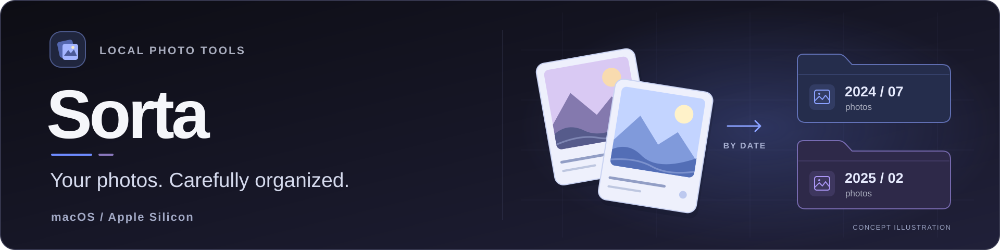
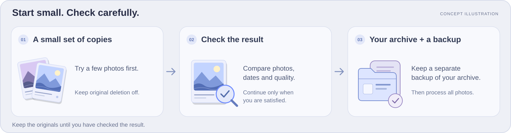

<p align="center">
  
</p>

# Sorta

*[Русский](README-ru.md)*

[Quick start](Docs/en/quick-start.md) · [Documentation](Docs/en/index.md) · [Command-line version](Docs/en/cli.md) · [Support the developer](https://boosty.to/andreytorlopov)

## Why Sorta exists

A photo archive grows one trip, one phone and one copied folder at a time. Eventually, photographs are scattered across directories and file dates no longer tell a consistent story.

Sorta helps organize that archive on your Mac: sort supported photos and videos into dated folders, convert DNG images to HEIC, and repair or set file dates. You choose the folders and options; processing runs locally, without an app account.

Your photographs matter more than a tidy directory. Start with a small set of **copies**, inspect the result, and keep a backup of the originals.

<p align="center">
  
</p>

## Availability

- **macOS 15.1 or later**, **Apple Silicon**. Sorta is a native Mac application, not an iPhone or iPad app.
- **Russian and English** interface and documentation. Change the app language in Settings.
- **System, Light and Dark** appearance, with your choice saved between launches.
- The source code is public. A **free Mac App Store release is being prepared**; a public repository does not mean the app is available in the store.

[Run the project from source →](Docs/en/development.md) · [Release status and verified limits →](Docs/en/releases.md)

## Start with a small copy

1. Make a small test copy of your photographs and choose an empty destination folder.
2. Read the first-launch information. **Close** becomes available after 30 seconds; the same text remains in **Help → Important Information**.
3. Choose the test folder, open **Sort photos**, and select the destination.
4. Keep **Create folder structure in destination** enabled and **Delete after processing** disabled. Review the renaming and file-date options before starting.
5. Run the operation. Open the results, check names and dates, and confirm that the originals are still present. Only then move on to your archive, with a backup.

Turning folder-structure creation off uses each file's source directory; it does not create a flat copy in the selected destination. Date tools change file attributes, not every embedded EXIF field. [Quick start and operation details →](Docs/en/quick-start.md)

## What is included

| For your photographs | For the workflow |
|---|---|
| Sorting supported photos and videos into year/month folders | Folder selection and drag-and-drop |
| Optional date-based file naming | Progress, operation messages and cancellation |
| DNG → HEIC conversion | A reminder to test copies before bulk processing |
| Repairing file dates or setting a custom date | RU/EN and System/Light/Dark settings |
| Shared processing engine with the CLI | Local processing; no app account |

Conversion is not a backup. Check image quality and metadata before deleting originals. Supported formats, output locations and date behavior are described in [Features and limits](Docs/en/features.md).

## Prefer Terminal?

[PhotoSorterCLI](https://github.com/andrey-torlopov/PhotoSorterCLI) uses the same [PhotoSorterCore](https://github.com/andrey-torlopov/PhotoSorterCore) engine through macOS Terminal. The CLI also exposes operations such as PNG → HEIC and date/name checking. The prepared **0.2.0** version adds RU/EN; these commands apply to that version after it becomes available:

```sh
photos-sorter-cli --language en
photos-sorter-cli --language ru
```

The CLI is a separate program; Sorta does not require it. The new CLI package is still completing its release checks. [CLI guide and distribution status →](Docs/en/cli.md)

## Documentation

- [Quick start](Docs/en/quick-start.md)
- [Features, formats and limits](Docs/en/features.md)
- **[Files, dates, originals and privacy](Docs/en/data-and-privacy.md)**
- [Command-line version](Docs/en/cli.md)
- [Development and architecture](Docs/en/development.md)
- [Release status and verification](Docs/en/releases.md)
- [All documentation](Docs/en/index.md)

## Support and the developer

[Support guide](SUPPORT.md) · [Privacy policy](PRIVACY.md) · [Report an issue](https://github.com/andrey-torlopov/Sorta/issues) · [mail@torlopov.dev](mailto:mail@torlopov.dev)

Developed by **Andrey Torlopov**. You can follow the developer and support the work on **[Boosty](https://boosty.to/andreytorlopov)**. Support is voluntary and does not unlock application features.

[Sorta source](https://github.com/andrey-torlopov/Sorta) · [CLI source](https://github.com/andrey-torlopov/PhotoSorterCLI) · [Processing engine](https://github.com/andrey-torlopov/PhotoSorterCore)
